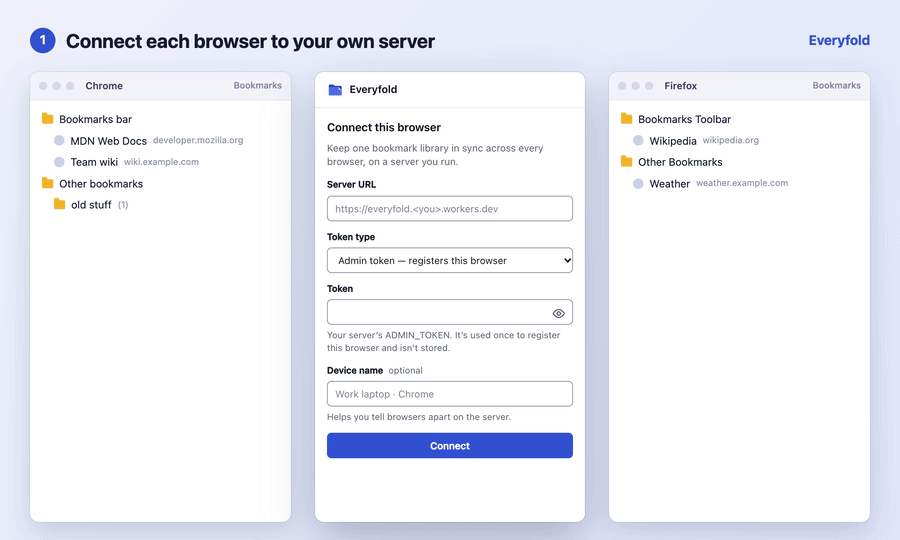
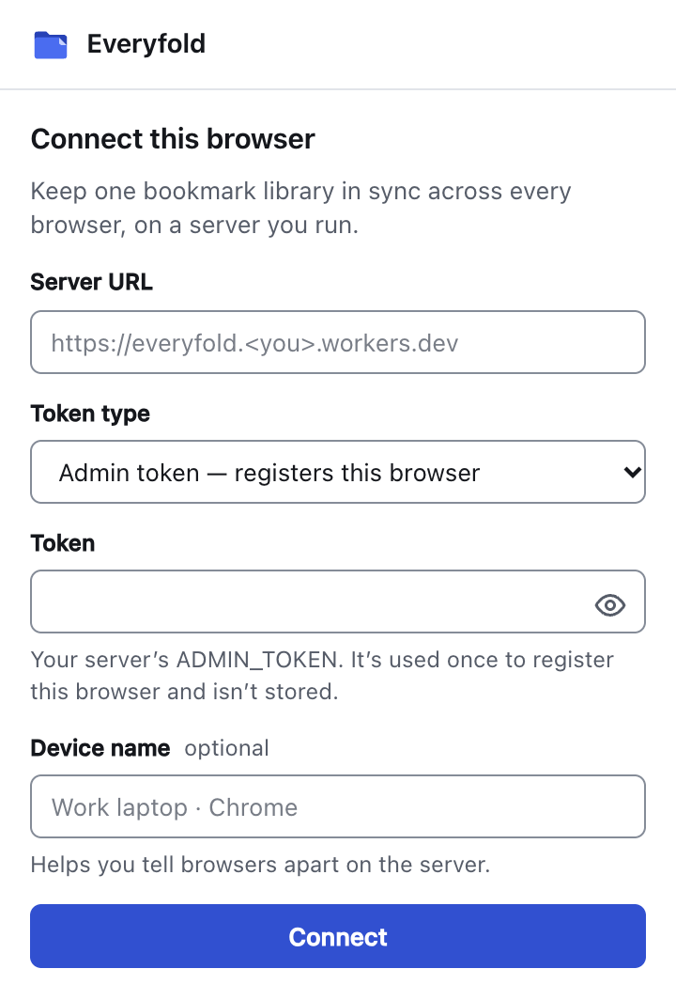
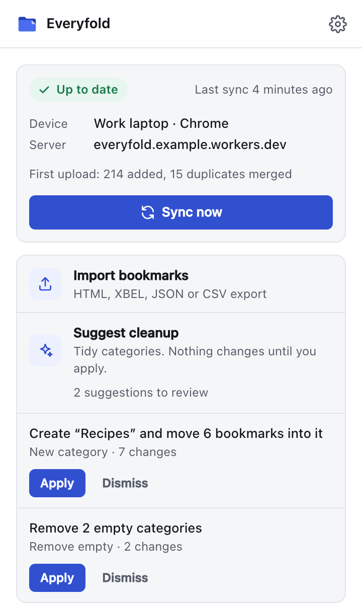
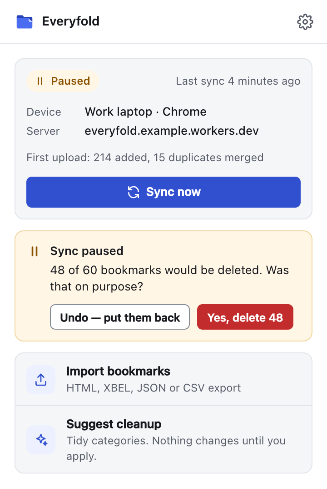
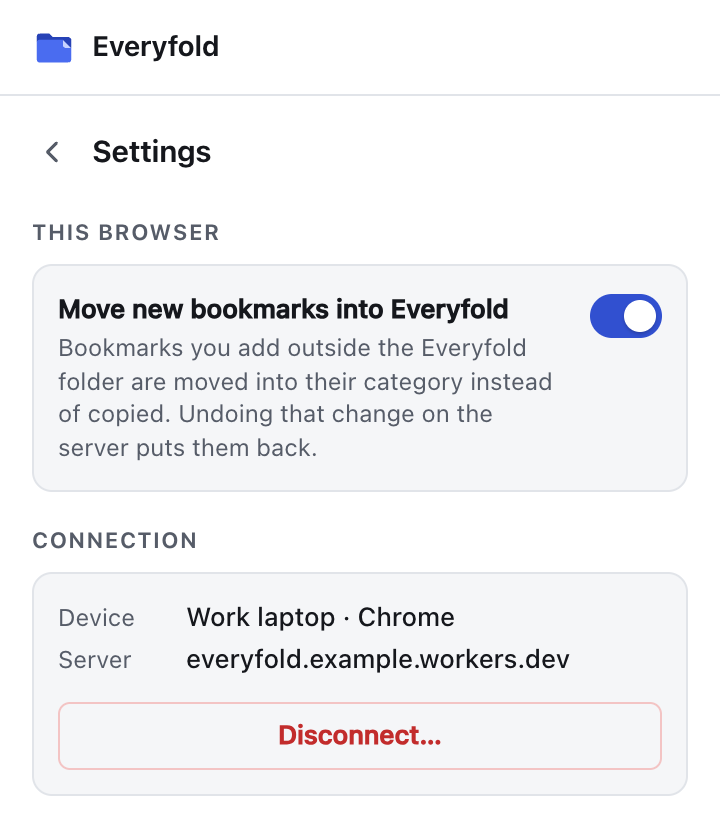

<p align="center">
  
</p>

<h1 align="center">Everyfold</h1>

<p align="center">
  <b>열린 창을 저장해 어느 브라우저에서든 그대로 다시 열고, Chrome·Edge·Brave·Firefox 북마크 동기화를 내 서버로 — 모든 브라우저에 북마크 저장소 하나, 폴더 자동 정리, 내 무료 Cloudflare Worker 에서.</b>
</p>

<p align="center">
  <a href="https://github.com/xero0429/everyfold/releases/latest"></a>
  <a href="https://github.com/xero0429/everyfold/actions/workflows/ci.yml"></a>
  <a href="LICENSE"></a>
  <a href="https://chromewebstore.google.com/detail/everyfold/jkdaehjboglabiaebmpnkgecmkkihgbd"></a>
  <a href="#2-확장-설치"></a>
  <a href="#2-확장-설치"></a>
  <a href="#1-서버-배포"></a>
</p>

<p align="center">
  <a href="README.md">English</a> · <a href="README.ko.md">한국어</a> · <a href="#빠른-시작">빠른 시작</a> · <a href="#자주-묻는-질문">자주 묻는 질문</a> · <a href="#다른-북마크-도구와-비교">비교</a>
</p>

<p align="center">
  
</p>

Everyfold 는 오픈소스 **크로스 브라우저 북마크 동기화**(cross-browser bookmark sync) 겸 **북마크 자동 정리** 도구입니다. **내 무료 Cloudflare Worker(GitHub 에서 버튼 한 번으로 배포)에 북마크 저장소 하나**를 두고, 연결한 모든 브라우저(현재 Chrome·Edge·Brave·Firefox)의 `Everyfold` 폴더에 똑같이 비춰 줍니다. 새 북마크는 카테고리 폴더로 자동 분류됩니다 — 기본 도메인 규칙, 내가 옮긴 기록에서 배운 규칙, 그리고 (선택) AI(LLM).

Everyfold 계정도, Everyfold 가 운영하는 서버도 없습니다. **서버는 내가 한 번 배포하고**(5분쯤, Cloudflare 무료 플랜으로 충분) **새 버전이 나오면 내가 업데이트합니다**(GitHub Actions 에서 버튼 한 번 — [서버 업데이트](#서버-업데이트)). 북마크는 그 서버로만 갑니다.

## 기능

- 🪟 **어디서든 창 다시 열기.** 팝업의 *열린 창 저장* 이 창마다 탭을 북마크 폴더로 남깁니다(`Everyfold/세션/<날짜 · 기기>/창 1, 2…`). 다른 북마크처럼 동기화되므로 나중에 다른 브라우저나 다른 컴퓨터에서 복구합니다 — 저장한 창마다 새 창 하나. 페이지 주소만 되살립니다(탭 기록·고정 탭·탭 그룹은 아님). 북마크로 못 담는 주소(`chrome://`, `about:`, `file:`, 확장 페이지)와 시크릿 창은 건너뜁니다. `tabs` 권한은 선택 권한이라 처음 저장할 때만 묻고, 복구는 권한 없이 됩니다. 서버 0.1.3 이상이 필요합니다. 저장한 창은 자동 분류·정리 제안이 옮기거나 지우지 않습니다.
- 🔖 **진짜 브라우저 북마크.** 따로 열 앱이 없습니다. `Everyfold` 폴더가 각 브라우저 북마크 안에 있습니다(Chrome: 기타 북마크, Firefox: 기타 북마크).
- 🔄 **브라우저 사이 동기화.** Chrome·Edge·Brave·Firefox(미리보기)가 저장소 하나를 같이 씁니다. 바꿀 때, 5분마다, 창에 다시 포커스가 올 때 동기화합니다.
- 🗂️ **자동 분류.** 규칙 → 학습 → (선택) Claude Haiku. LLM 은 새 카테고리를 *제안*만 하고, 승인해야 생깁니다.
- 🛡️ **기존 폴더는 그대로, 큰 삭제는 먼저 묻기.** 처음 연결할 때 기존 북마크를 저장소로 *복사*하고(중복은 합침) 원본은 그대로 둡니다. 한 번에 북마크 20% 이상이 지워지면 멈추고 (팝업에서) 묻습니다. 모든 변경은 기록되어 되돌릴 수 있고 하루 1번 스냅샷을 복원할 수 있습니다 — 둘 다 지금은 서버 API 로만 합니다([되돌리기·스냅샷](#되돌리기스냅샷)). 화면은 아직 없습니다.
- ☁️ **내 서버(셀프 호스팅), 무료 티어로 충분.** 내 Cloudflare 계정의 Worker 하나 + D1. Docker·VPS 는 필요 없지만, 내 서버이므로 업데이트도 내가 배포합니다.
- 📥 **다른 도구에서 가져오기.** Netscape HTML(모든 브라우저), Floccus(XBEL/HTML), Karakeep(JSON), Linkwarden(JSON), Raindrop.io(CSV/HTML).

## 화면

<table>
  <tr>
    <td width="25%" valign="top"><picture><source media="(prefers-color-scheme: dark)" srcset="docs/assets/screens/connect-dark.png"></picture></td>
    <td width="25%" valign="top"><picture><source media="(prefers-color-scheme: dark)" srcset="docs/assets/screens/connected-dark.png"></picture></td>
    <td width="25%" valign="top"><picture><source media="(prefers-color-scheme: dark)" srcset="docs/assets/screens/mass-dark.png"></picture></td>
    <td width="25%" valign="top"><picture><source media="(prefers-color-scheme: dark)" srcset="docs/assets/screens/settings-dark.png"></picture></td>
  </tr>
  <tr>
    <td align="center">브라우저 <b>연결</b></td>
    <td align="center"><b>동기화</b>와 정리 제안</td>
    <td align="center"><b>큰 삭제</b>는 먼저 묻기</td>
    <td align="center">새 북마크 <b>복사·옮기기</b></td>
  </tr>
</table>

화면 캡처의 문구는 영어입니다(확장 화면은 현재 영어).

## 빠른 시작

1. **서버 배포** — [](https://deploy.workers.cloudflare.com/?url=https://github.com/xero0429/everyfold) 를 누르고 `ADMIN_TOKEN`(`openssl rand -hex 32`)을 넣습니다. `https://everyfold.<내-서브도메인>.workers.dev` 가 생깁니다. → [자세히](#1-서버-배포)
2. **확장 설치** — Chrome·Edge·Brave 는 [Chrome 웹 스토어](https://chromewebstore.google.com/detail/everyfold/jkdaehjboglabiaebmpnkgecmkkihgbd)에서 설치합니다. Firefox 는 [최신 릴리스](https://github.com/xero0429/everyfold/releases/latest)의 zip 을 임시 부가 기능으로 올립니다(Firefox 부가 기능 등록은 아직). → [자세히](#2-확장-설치)
3. **브라우저마다 연결** — Everyfold 아이콘 → 서버 URL·관리자 토큰·기기 이름 → *Connect*. → [자세히](#3-브라우저마다-연결)

그다음 한 번만: [내 복사본에 업데이트 워크플로 넣기](#서버-업데이트) — 이후 서버 업데이트는 버튼 한 번입니다.

## 5분 설치(자세히)

### 1. 서버 배포

[](https://deploy.workers.cloudflare.com/?url=https://github.com/xero0429/everyfold)

버튼이 이 저장소를 **내 GitHub 계정의 새 저장소로 복사**하고(GitHub fork 가 아닌 복사본), D1 데이터베이스를 만들고, 새 저장소를 [Workers Builds](https://developers.cloudflare.com/workers/ci-cd/builds/) 에 연결한 뒤(그 저장소에 push 하면 다시 배포) `deploy` 스크립트를 돌립니다 — 배포 전에 D1 마이그레이션을 먼저 적용합니다(`wrangler d1 migrations apply DB --remote && wrangler deploy`). 그리고 비밀값 `ADMIN_TOKEN` 을 묻습니다.

| 비밀값 | |
|---|---|
| `ADMIN_TOKEN` | 필수. 브라우저마다 한 번 확장에 붙여 넣습니다. 긴 무작위 문자열(`openssl rand -hex 32`). |
| `ANTHROPIC_API_KEY` | 선택 — 버튼은 묻지 않습니다. LLM 분류를 켭니다(없으면 규칙 + 학습만). 배포 뒤 Worker → **Settings → Variables and Secrets** → Add(Secret 종류) 또는 `npx wrangler secret put ANTHROPIC_API_KEY` 로 넣습니다. |

명령줄로 배포하려면:

```sh
git clone https://github.com/xero0429/everyfold && cd everyfold
corepack enable && pnpm install
npx wrangler d1 create everyfold        # 나온 database_id 를 wrangler.toml 에 넣기
npx wrangler secret put ADMIN_TOKEN
npx wrangler secret put ANTHROPIC_API_KEY   # 선택
pnpm run deploy
```

### 2. 확장 설치

**Chrome·Edge·Brave(Chromium 계열)**

[Chrome 웹 스토어](https://chromewebstore.google.com/detail/everyfold/jkdaehjboglabiaebmpnkgecmkkihgbd)에서 Everyfold 를 설치하고, 퍼즐 조각 메뉴에서 고정하면 아이콘이 툴바에 남습니다. 업데이트는 브라우저가 알아서 합니다. Edge 는 "다른 스토어의 확장 허용"을 물으면 허용합니다.

릴리스 zip 으로 개발자 모드 설치를 해 쓰고 있었다면: 스토어판은 별개의 확장입니다. `chrome://extensions` 에서 압축해제 확장을 지운 뒤 스토어판을 다시 연결하세요(3단계).

<details><summary>스토어 대신 릴리스 zip 으로 개발자 모드 설치</summary>

1. 최신 릴리스에서 `everyfold-chrome-<버전>.zip` 을 받아 계속 둘 폴더(예: `~/Everyfold/chrome`)에 풉니다(지우면 안 됩니다 — 브라우저가 이 폴더에서 확장을 읽습니다).
2. `chrome://extensions`(Edge: `edge://extensions`, Brave: `brave://extensions`)를 열고 **개발자 모드** 를 켭니다.
3. **압축해제된 확장 프로그램 로드** → 푼 폴더(`manifest.json` 이 있는 폴더)를 고릅니다.
4. 퍼즐 조각 메뉴에서 Everyfold 를 고정하면 아이콘이 툴바에 남습니다.

스토어 밖 확장이라 Chrome 이 시작할 때 "개발자 모드 확장" 안내를 띄울 수 있습니다. 정상입니다.

**업데이트:** 새 zip 을 받아 **같은 폴더에 덮어 풀고**, `chrome://extensions` 의 Everyfold 카드에서 새로고침 ↻ 을 누릅니다. 폴더 경로는 바꾸지 마세요. 압축해제 확장은 경로로 신원이 정해져서, 다른 폴더면 새 확장으로 보고 다시 연결해야 합니다.

</details>

**Firefox(140 이상)**

Firefox 부가 기능에는 아직 없으므로 [Releases 페이지](https://github.com/xero0429/everyfold/releases/latest) 의 zip 을 씁니다.

1. `everyfold-firefox-<버전>.zip` 을 받습니다.
2. `about:debugging#/runtime/this-firefox` → **임시 부가 기능 로드…** → zip(또는 푼 폴더의 `manifest.json`)을 고릅니다.

임시 부가 기능은 Firefox 를 다시 켜면 사라지고, 정식 Firefox 는 Mozilla 서명이 있는 부가 기능만 계속 설치하므로 지금 Firefox 는 체험용입니다. 서명된 판은 Firefox 부가 기능 등록과 함께 나옵니다. (Developer Edition·Nightly 는 `about:config` 의 `xpinstall.signatures.required = false` 로 zip 을 계속 설치할 수 있습니다.)

<details><summary>직접 빌드하려면</summary>

```sh
pnpm install && pnpm build:extension     # → apps/extension/dist/chrome, dist/firefox
pnpm package:extension                    # → apps/extension/dist/store/ 에 zip
```

`apps/extension/dist/chrome` 을 압축해제 로드하거나, `apps/extension/dist/firefox/manifest.json` 을 임시 부가 기능으로 로드합니다.
</details>

Firefox 빌드는 만들어지고 타입 검사·Firefox 모양 북마크 트리로 엔진 시험을 하지만, **실제 Firefox 에서는 아직 돌려 보지 않았습니다**(끝-끝 시험은 Chromium 만).

> **Chrome 계정 동기화:** 같은 Google 계정으로 북마크 동기화를 켠 Chrome 프로필이 여럿이면 Chrome 이 `Everyfold` 폴더를 스스로 복제합니다. 그 프로필에서 Everyfold 를 연결하면(하나만 연결해도 됩니다) 첫 동기화 때 이미 복제된 폴더·북마크(같은 자리의 같은 폴더 이름·같은 URL)를 그대로 채택해 두 벌이 생기지 않습니다. 두 동기화가 서로 다투지 않게 그 프로필들에서는 Chrome 자체 북마크 동기화를 끄는 편이 낫습니다.

### 3. 브라우저마다 연결

툴바의 Everyfold 아이콘 → 서버 URL, 관리자 토큰, 기기 이름 → 연결. 관리자 토큰은 등록에 한 번만 쓰고 저장하지 않습니다.

이후 북마크를 바꿀 때, 5분마다, 창으로 돌아올 때 동기화됩니다.

**설정(브라우저마다, 팝업)**

- *새 북마크를 Everyfold 로 옮기기(Move)* — 기본 꺼짐. 꺼져 있으면 `Everyfold` 폴더 밖에서 만든 북마크를 카테고리 폴더에 **복사**하고 원본은 둡니다(두 개로 보임). 켜면 그 북마크 자체를 카테고리 폴더로 **옮겨** 하나만 남깁니다. 나중에 서버에서 그 변경을 되돌리면 지우지 않고 처음 만든 자리로 돌려놓습니다. 첫 연결 뒤 팝업이 이 설정을 한 번 안내하며, 켜기 전에는 아무것도 옮기지 않습니다.
- *열린 창 저장* — 시크릿이 아닌 모든 창의 탭을 한 묶음으로 저장합니다. 아래 목록의 *복구* 는 저장한 창마다 새 창을 열고, *지우기* 는 모든 브라우저에서 그 묶음을 지웁니다. 처음 저장할 때 `tabs` 권한을 묻고, 거절해도 다른 기능은 그대로입니다.
- *Suggest cleanup(정리 제안)* — 서버에 정리 제안을 요청합니다(미분류를 규칙대로 정리·빈 카테고리 지우기·LLM 이 제안한 새 카테고리). 각 제안은 *Apply* 를 눌러야 적용됩니다.

**언어.** 기본 카테고리 이름·서버 문구·LLM 제안 이름은 영어/한국어가 있습니다. Worker 에 `LOCALE` 변수(`en` 또는 `ko`)를 두면 그 언어, 없으면 처음 연결한 브라우저의 언어(둘 다 아니면 영어)를 씁니다.

## 서버 업데이트

확장은 연결할 때와 대략 1시간마다 서버 판(`GET /version`)을 봅니다. 서버가 확장이 기대하는 것보다 낡았으면 팝업에 **Server is out of date** 와 이 절 링크가 뜹니다. 동기화는 계속됩니다. 그대로 두면 데이터가 망가질 수 있는 변경일 때만 업데이트할 때까지 동기화를 멈춥니다("Server update required").

Deploy 버튼이 만든 것은 fork 가 아니라 *복사본*이라 GitHub 의 *Sync fork* 버튼이 없습니다. 대신 업데이트 워크플로를 씁니다.

**배포한 뒤 한 번만: 내 복사본에 업데이트 워크플로 넣기.** Deploy 버튼은 코드는 복사하지만 `.github/workflows/` 폴더는 복사하지 않아서, 복사본에는 아직 워크플로가 없습니다. 한 번만 넣어 줍니다(`<you>/<repo>` 는 내 복사본 — Deploy 화면에서 정한 저장소 이름 — 으로 바꿉니다).

1. `https://github.com/<you>/<repo>/new/main?filename=.github/workflows/update-from-upstream.yml` 을 엽니다(GitHub 의 *Add file → Create new file* 에 파일 이름이 미리 채워진 화면).
2. [update-from-upstream.yml](https://raw.githubusercontent.com/xero0429/everyfold/main/.github/workflows/update-from-upstream.yml) 내용 전체를 고치지 말고 붙여 넣고 **Commit changes**(`main` 에) 를 누릅니다. 이 파일은 이미 이 저장소를 가리키므로 복사본 이름이 무엇이든 그대로 동작합니다.

   또는 [GitHub CLI](https://cli.github.com/) 로(`workflow` 권한이 필요합니다: `gh auth refresh -s workflow`):

   ```sh
   curl -fsSL https://raw.githubusercontent.com/xero0429/everyfold/main/.github/workflows/update-from-upstream.yml -o update-from-upstream.yml &&
   gh api -X PUT repos/<you>/<repo>/contents/.github/workflows/update-from-upstream.yml \
     -f message="Add update workflow" -f content="$(base64 < update-from-upstream.yml | tr -d '\n')"
   ```

이 커밋으로도 평소처럼 다시 배포되는데, 문제없습니다. 복사본에 **Actions** 가 꺼져 있으면 *Settings → Actions → General → Actions permissions* 에서 켭니다. 워크플로는 `contents: write` 권한을 스스로 요청합니다. 그래도 push 가 거절되면(`403`) *Settings → Actions → General → Workflow permissions* 를 **Read and write permissions** 로 바꿉니다.

**업데이트할 때마다:**

1. GitHub 의 내 복사본 → **Actions** → **Update from upstream** → **Run workflow**(브랜치 `main`, upstream ref 는 `main` 또는 릴리스 태그). 처음이면 그 저장소에서 Actions 를 켜라고 할 수 있습니다.
2. 워크플로가 최신 Everyfold 코드를 내 저장소에 커밋합니다. `wrangler.toml` 의 Worker 이름과 D1 `database_name`·`database_id`, `package.json` 의 프로젝트 `name` 은 내 값을 그대로 두고, `.github/workflows/` 는 건드리지 않습니다 — GitHub 는 워크플로가 워크플로 파일 변경을 push 하지 못하게 합니다. upstream 과 다른 워크플로 파일은 목록으로 알려 주니, 바꾸려면 위의 한 번 넣기처럼 GitHub 에서 그 파일을 열어 새 내용을 붙여 넣습니다. 지운 파일 목록과, 내 `wrangler.toml` 에서 옮기지 않은 줄도 로그에 남깁니다(변수는 `wrangler.toml` 이 아니라 Cloudflare 대시보드에서 정하세요). 내 설정을 안전하게 지킬 수 없을 때 — `wrangler.toml` 이 없거나, 대신 `wrangler.json`/`wrangler.jsonc` 가 있거나, `database_id` 가 사라질 상황 — 에는 아무것도 바꾸지 않고 멈춥니다. 그때는 아래 merge 로 직접 업데이트합니다.
3. push 를 본 Workers Builds 가 다시 배포합니다. `deploy` 스크립트가 새 D1 마이그레이션을 먼저 적용하므로 DB 스키마도 함께 올라갑니다. Cloudflare 대시보드 *Workers & Pages → everyfold → Deployments* 에서 확인합니다.

자동으로 받고 싶으면 `.github/workflows/update-from-upstream.yml` 의 `schedule:` 줄 주석을 풉니다.

<details><summary>명령줄로 하거나, 코드를 직접 고쳐 쓰는 경우</summary>

워크플로는 `node scripts/update-from-upstream.mjs` 를 돌리는데, 이것은 코드를 upstream 것으로 **바꿔 씁니다**(위 값만 빼고). 내 수정을 지키려면 대신 merge 합니다.

```sh
git remote add upstream https://github.com/xero0429/everyfold.git
git fetch upstream
git merge upstream/main --allow-unrelated-histories   # --allow-unrelated-histories 는 처음 한 번만
# wrangler.toml 이 충돌하면 내 database_id·name 을 남긴다
git push                                               # Workers Builds 가 다시 배포
```

Workers Builds 없이 명령줄로 배포했다면 `git pull`(또는 위 merge) 뒤 `pnpm run deploy`.
</details>

Cloudflare 대시보드에서 정한 변수(`LOCALE` 등)는 다시 배포해도 남습니다(`wrangler.toml` 의 `keep_vars = true`). 비밀값은 항상 남습니다.

## 되돌리기·스냅샷

지금은 API 로 합니다(기기 토큰 사용 — 확장에 저장된 것, 또는 관리자 토큰으로 `POST /devices` 해서 새로 발급):

```sh
S=https://everyfold.<you>.workers.dev; T=<기기 토큰>
curl -H "authorization: Bearer $T" "$S/changes?limit=20"                       # 최근 변경 묶음(최신순)
curl -H "authorization: Bearer $T" -X POST "$S/changes/undo" -H 'content-type: application/json' -d '{"batchId":"<batch_id>"}'
curl -H "authorization: Bearer $T" "$S/snapshots"                               # 매일(KST 03:00) + 수동 스냅샷
curl -H "authorization: Bearer $T" -X POST "$S/snapshots"                       # 지금 하나 만들기
curl -H "authorization: Bearer $T" -X POST "$S/snapshots/<id>/restore"          # 복원 전 스냅샷을 먼저 남김
```

되돌리기는 그 묶음이 건드린 노드를 묶음 직전 상태로 "새 변경" 으로 다시 씁니다(그래서 되돌리기도 다시 되돌릴 수 있음). 브라우저는 다음 동기화 때 반영합니다.

## Cloudflare 무료 플랜

무료 플랜 Worker 요청 하나는 D1 호출을 50번까지 할 수 있습니다. push 는 D1 batch 한 번으로 쓰고 폴더 삭제는 문 하나라서, 크기가 커져도 D1 호출 수가 늘지 않습니다(시험: 섞인 op 300개 push = 15번 이하, 25번 넘으면 실패). 무료 D1 에는 하루 읽기·쓰기 행 수 한도도 있어, 수만 개 규모는 들어가지만 아주 큰 라이브러리의 첫 가져오기는 하루 쓰기 한도를 넘을 수 있습니다.

## 로컬 실행(개발)

```sh
corepack enable && pnpm install
cp .dev.vars.example .dev.vars        # ADMIN_TOKEN 설정 (선택: ANTHROPIC_API_KEY 주석 해제)
pnpm dev                              # http://localhost:8787 (로컬 D1)
pnpm build:extension
pnpm typecheck && pnpm test
pnpm --filter @everyfold/extension e2e   # 실제 Chromium + wrangler dev
pnpm package:extension                # 스토어 제출용 zip → apps/extension/dist/store/ (docs/store/ 참조)
```

## 다른 북마크 도구와 비교

| | Everyfold | Floccus | Karakeep | Linkwarden | TidyMark |
|---|---|---|---|---|---|
| 성격 | 브라우저 간 북마크 동기화 + 자동 정리 | 북마크 동기화 확장(+모바일 앱) | 북마크/나중에 읽기 앱 | 협업 북마크 관리·보관 | 북마크 정리 확장 |
| 브라우저 기본 북마크를 브라우저끼리 동기화 | 예(`Everyfold` 폴더) | 예 | Floccus 로 | Floccus 로 | 아니오 |
| 자동 분류 | 규칙+학습+선택 LLM(새 카테고리는 승인) | — | LLM 자동 태그(OpenAI/Ollama) | 선택 AI 태그 | 규칙+선택 AI |
| 내가 돌리는 서버 | 내 계정의 Cloudflare Worker + D1(무료 플랜, 버튼 한 번 배포·업데이트) | 고르는 백엔드: Nextcloud·WebDAV·Git·Google Drive 등 | Docker 서버(또는 유료 클라우드) | Docker 서버(또는 유료 클라우드) | 없음(확장만) |
| 라이선스 | MIT | MPL-2.0 | AGPL-3.0 | AGPL-3.0 | MIT |

## 자주 묻는 질문

### 무료인가요?

네. Everyfold 는 MIT 라이선스이고, 서버는 Cloudflare 무료 Workers + D1 플랜에서 돕니다(한도는 [Cloudflare 무료 플랜](#cloudflare-무료-플랜)). 선택 비용은 AI 분류뿐입니다. `ANTHROPIC_API_KEY` 를 넣으면 Claude Haiku 호출 요금이 Anthropic 에서 내 계정으로 청구됩니다. 키가 없으면 규칙과 학습으로 분류합니다.

### 북마크는 어디에 저장되고, 누가 볼 수 있나요?

내가 배포한 Worker 의 D1 데이터베이스, 곧 내 Cloudflare 계정 안입니다. Everyfold 계정·Everyfold 운영 서버·분석·원격 수집이 없습니다. AI 분류를 켜면 규칙으로 못 정한 북마크의 제목·URL 을 카테고리 이름과 함께 내 서버가 내 키로 Anthropic API 에 보냅니다. [PRIVACY.md](PRIVACY.md) 를 보세요.

### 기존 북마크를 마음대로 옮기나요?

아니요. 처음 연결할 때 북마크를 `Everyfold` 폴더로 *복사*하고(중복은 합침) 내 폴더는 그대로 둡니다. 폴더 밖에 새로 저장한 북마크도 기본은 카테고리로 복사합니다. 한 벌만 두고 싶으면 *새 북마크를 Everyfold 로 옮기기(Move)* 를 켭니다.

### 어떤 브라우저에서 되나요?

Chrome·Edge·Brave 등 Chromium 브라우저(Manifest V3)와 Firefox 140 이상입니다. Firefox 판은 새로 만들어 아직 실제 Firefox 에서 써 보지 않았으니 미리보기로 봐 주세요. Safari 와 모바일 브라우저는 지원하지 않습니다.

### Cloudflare 를 알거나 서버를 돌려야 하나요?

터미널은 필요 없습니다. Deploy 버튼이 Worker 와 데이터베이스를 만들어 주고, 업데이트는 GitHub Actions 에서 버튼 한 번입니다. 무료 Cloudflare 계정과 GitHub 계정은 있어야 합니다.

### Floccus·Raindrop.io·Karakeep 와 무엇이 다른가요?

Floccus 는 내가 고른 백엔드로 북마크를 동기화하지만 정리는 하지 않습니다. Raindrop.io 는 자체 앱이 있는 호스팅 북마크 서비스이고, Karakeep·Linkwarden 은 자체 앱이 있는 북마크 관리 도구로 Docker 로 직접 호스팅(또는 유료 클라우드)합니다. Everyfold 는 북마크를 브라우저 자체 북마크 바·메뉴에 두고, 버튼 한 번으로 만드는 무료 서버를 함께 쓰며, 새 북마크를 폴더로 정리해 줍니다. [비교 표](#다른-북마크-도구와-비교)를 보세요.

### Chrome 자체 북마크 동기화와 같이 써도 되나요?

네. [확장 설치](#2-확장-설치)의 *Chrome 계정 동기화* 안내를 보세요.

## 알려진 한계

- 폴더 안 형제 순서는 아직 동기화하지 않습니다(새 항목은 끝에 붙음).
- *열린 창 저장* 은 페이지 주소만 되살립니다 — 탭 기록·고정 탭·탭 그룹·창 위치는 아님. 창 폴더 이름(`창 1`)은 브라우저 언어를, `세션` 폴더 이름은 서버의 카테고리 언어를 따릅니다. `세션` 폴더는 `Everyfold` 바로 아래에 두세요 — 다른 폴더 안으로 옮기면 다음에 창을 저장할 때 제자리로 돌아옵니다(저장한 창은 그대로). 북마크 파일을 가져와도 `세션` 폴더가 하나 더 생기지 않고, 그 이름 폴더 아래 항목은 미분류로 갑니다.
- 기본 카테고리 이름은 영어·한국어만 있습니다(위 *언어*). 이름은 마음대로 바꿔도 되고, 바꾼 이름도 동기화되며 분류는 바뀐 폴더로 계속 들어갑니다.
- Safari 미지원. Firefox 는 부가 기능(AMO) 등록 전 — 릴리스 zip 을 임시 부가 기능으로 올리고, 업데이트는 직접 합니다(*확장 설치* 참조).
- 첫 연결 뒤 각 브라우저에는 원래 북마크와 `Everyfold` 사본이 함께 있습니다(의도된 동작). 새 북마크는 *Move* 설정으로 복사 대신 옮길 수 있습니다.
- 되돌리기·스냅샷·충돌 기록은 아직 화면이 없습니다(API 만).
- 서버 업데이트는 업데이트 워크플로의 schedule 을 켜지 않는 한 자동이 아닙니다([서버 업데이트](#서버-업데이트)).

개인정보: 분석·원격 수집 없음, Everyfold 가 운영하는 서버 없음 — [PRIVACY.md](PRIVACY.md)

기여: [CONTRIBUTING.md](CONTRIBUTING.md) · 라이선스: [MIT](LICENSE)

---

Made by Chanyoung Jeong ([@xero0429](https://github.com/xero0429))
